# Unidad 1 · Tarea 1.1: Fundamentos, objetivos y modelos de bases de datos

**Materia:** Estructura de Datos
**Alumno:** Ximena Sánchez Lugo
**Docente:** Rubén Miguel Riojas Rodríguez
**Institución:** Instituto Tecnológico Superior de Monclova (ITSM)

## Contenido de la carpeta

| Archivo | Descripción |
|---|---|
| [`Tarea1.1_Fundamentos_Modelos_BD.pdf`](Tarea1.1_Fundamentos_Modelos_BD.pdf) | Documento formal: portada, mapa conceptual, tabla comparativa y referencias en APA |
| [`mapa_conceptual.svg`](mapa_conceptual.svg) | Mapa conceptual en SVG (fuente vectorial) |
| [`mapa_conceptual.mmd`](mapa_conceptual.mmd) | Código Mermaid del mapa conceptual |
| [`mapa_conceptual.md`](mapa_conceptual.md) | Diagrama en Markdown (se muestra en GitHub) |
| [`mapa_conceptual.pdf`](mapa_conceptual.pdf) | Diagrama en PDF vectorial |
| [`tabla_comparativa_modelos.md`](tabla_comparativa_modelos.md) | Tabla comparativa de modelos en Markdown |

## Video explicativo

[Enlace de YouTube (pendiente de agregar)](https://youtube.com/)

---

## Introducción

En el ámbito de la informática y el desarrollo de software, la gestión eficiente de la información es un pilar fundamental. Las bases de datos permiten organizar, almacenar y consultar grandes volúmenes de datos de manera estructurada, garantizando la seguridad, la integridad y el acceso concurrente por parte de múltiples usuarios y aplicaciones. El presente documento aborda los conceptos esenciales de las bases de datos, sus objetivos primordiales, áreas de aplicación y una comparativa entre los principales modelos de datos empleados en la industria.

## Mapa conceptual analítico

```mermaid
graph TD
    BD[Bases de Datos] --> CF[Conceptos Fundamentales]
    BD --> OB[Objetivos Principales]
    BD --> US[Usos Comunes]
    BD --> AP[Áreas de Aplicación]

    %% Conceptos Fundamentales
    CF --> D[Dato: Unidad mínima sin contexto]
    CF --> I[Información: Datos procesados]
    CF --> SGBD[SGBD / DBMS: Sistema gestor]
    CF --> T[Tupla / Registro: Fila]
    CF --> A[Atributo / Campo: Columna]

    %% Objetivos Principales
    OB --> O1[Independencia de datos]
    OB --> O2[Reducción de redundancia]
    OB --> O3[Integridad y consistencia]
    OB --> O4[Seguridad y control de acceso]
    OB --> O5[Concurrencia de usuarios]

    %% Usos Comunes
    US --> U1[Transacciones financieras]
    US --> U2[Gestión de inventarios]
    US --> U3[Perfiles y credenciales]

    %% Áreas de Aplicación
    AP --> A1[Comercio Electrónico / E-commerce]
    AP --> A2[Banca y Finanzas]
    AP --> A3[Salud y Medicina]
    AP --> A4[Educación y LMS]
```

Ver código Mermaid

### Explicación de los componentes

**Conceptos fundamentales**
- **Dato:** unidad mínima de información sin contexto por sí sola.
- **Información:** conjunto de datos procesados y estructurados con significado contextual.
- **SGBD / DBMS:** software encargado de gestionar la creación, mantenimiento y manipulación de las bases de datos.
- **Tupla / Registro:** representación de un elemento o entidad única dentro de una estructura (fila).
- **Atributo / Campo:** característica o propiedad que describe a la entidad (columna).

**Objetivos principales**
- **Independencia de datos:** separación entre la estructura física de almacenamiento y las aplicaciones del usuario.
- **Reducción de la redundancia:** minimización de la duplicación innecesaria de datos.
- **Integridad y consistencia:** garantía de que la información almacenada cumple con las reglas de negocio y permanece válida.
- **Seguridad:** control de accesos y permisos restringidos.
- **Concurrencia:** capacidad de permitir el acceso simultáneo a múltiples usuarios sin conflicto.

**Usos comunes y áreas de aplicación**
- Administración de transacciones bancarias, control de inventarios, plataformas de comercio electrónico (e-commerce), gestión de expedientes clínicos y sistemas educativos LMS.

## Tabla comparativa de modelos de bases de datos

| Modelo | Definición | Forma de representación |
|---|---|---|
| **Jerárquico** | Organiza los datos en una estructura de árbol invertido (relación 1:N). Cada registro hijo tiene un único registro padre. | Nodos interconectados en niveles jerárquicos mediante enlaces unidireccionales. |
| **En Red** | Evolución del modelo jerárquico que permite relaciones de muchos a muchos (N:M). Un hijo puede conectarse a múltiples padres. | Grafos o redes donde los registros se relacionan mediante punteros multidireccionales. |
| **Relacional** | Modelo estándar que organiza los datos en tablas compuestas por filas y columnas interconectadas mediante claves. | Tablas bidimensionales (matrices de tuplas y atributos) conectadas por claves primarias y foráneas. |
| **Orientado a Objetos** | Almacena datos integrando conceptos del paradigma POO (clases, objetos, herencia, métodos y encapsulamiento). | Jerarquías de clases y objetos que encapsulan atributos y comportamientos. |
| **NoSQL** | Modelos no relacionales diseñados para alta escalabilidad, volumen y flexibilidad de datos no estructurados. | Colecciones de documentos (JSON), pares clave-valor, grafos o columnas anchas. |

## Conclusión

La selección de un modelo de base de datos depende estrictamente de las necesidades del sistema. Mientras que el modelo relacional destaca en consistencia y transaccionalidad, las alternativas como NoSQL y Orientadas a Objetos ofrecen flexibilidad y escalabilidad para la arquitectura de datos moderna.

## Referencias bibliográficas (APA)

- Coronel, C., & Morris, S. (2019). *Database systems: Design, implementation, & management* (13th ed.). Cengage Learning.
- Date, C. J. (2003). *An introduction to database systems* (8th ed.). Addison-Wesley.
- Elmasri, R., & Navathe, S. B. (2015). *Fundamentals of database systems* (7th ed.). Pearson.
- Silberschatz, A., Korth, H. F., & Sudarshan, S. (2020). *Database system concepts* (7th ed.). McGraw-Hill Education.
