# Mapa conceptual analítico

## Código Mermaid

```mermaid
graph TD
    BD[Bases de Datos] --> CF[Conceptos Fundamentales]
    BD --> OB[Objetivos Principales]
    BD --> US[Usos Comunes]
    BD --> AP[Áreas de Aplicación]

    %% Conceptos Fundamentales
    CF --> D[Dato: Unidad mínima sin contexto]
    CF --> I[Información: Datos procesados]
    CF --> SGBD[SGBD / DBMS: Sistema gestor]
    CF --> T[Tupla / Registro: Fila]
    CF --> A[Atributo / Campo: Columna]

    %% Objetivos Principales
    OB --> O1[Independencia de datos]
    OB --> O2[Reducción de redundancia]
    OB --> O3[Integridad y consistencia]
    OB --> O4[Seguridad y control de acceso]
    OB --> O5[Concurrencia de usuarios]

    %% Usos Comunes
    US --> U1[Transacciones financieras]
    US --> U2[Gestión de inventarios]
    US --> U3[Perfiles y credenciales]

    %% Áreas de Aplicación
    AP --> A1[Comercio Electrónico / E-commerce]
    AP --> A2[Banca y Finanzas]
    AP --> A3[Salud y Medicina]
    AP --> A4[Educación y LMS]
```

## Archivos del diagrama

- [`mapa_conceptual.svg`](mapa_conceptual.svg): fuente vectorial (SVG)
- [`mapa_conceptual.pdf`](mapa_conceptual.pdf): versión en PDF vectorial
- [`mapa_conceptual.mmd`](mapa_conceptual.mmd): código fuente Mermaid
