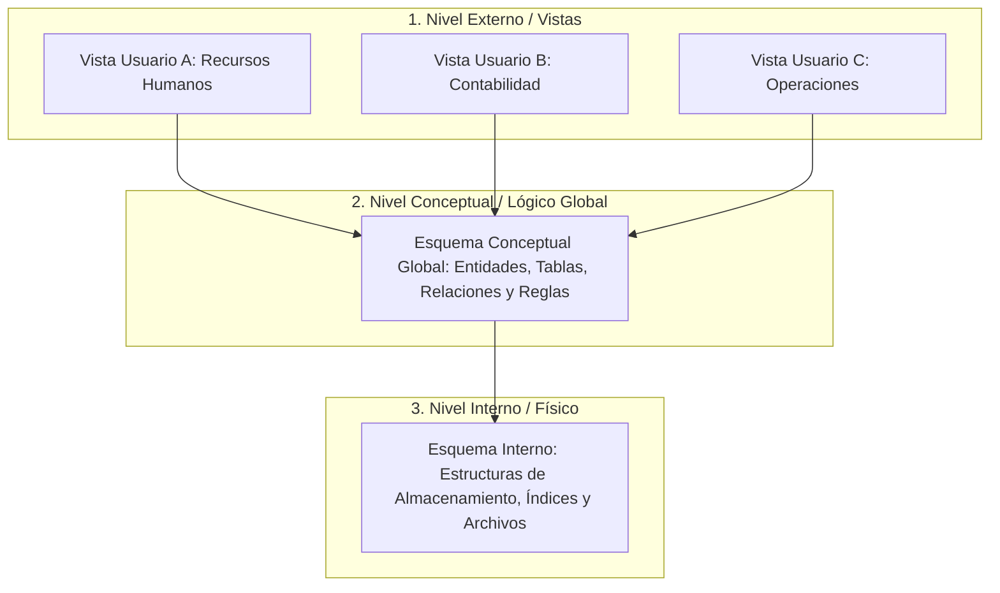

# Unidad 1 · Tarea 1.2: Clasificación y arquitectura de las bases de datos

**Materia:** Estructura de Datos
**Alumno:** Ximena Sánchez Lugo
**Docente:** Rubén Miguel Riojas Rodríguez
**Institución:** Instituto Tecnológico Superior de Monclova (ITSM)

## Contenido de la carpeta

| Archivo | Descripción |
|---|---|
| [`Tarea1.2_Clasificacion_Arquitectura_BD.pdf`](Tarea1.2_Clasificacion_Arquitectura_BD.pdf) | Documento formal con portada, desarrollo de los temas, conclusión y referencias |
| [`arquitectura_tres_niveles.svg`](arquitectura_tres_niveles.svg) | Diagrama de la arquitectura de tres niveles en SVG (fuente vectorial) |
| [`arquitectura_tres_niveles.mmd`](arquitectura_tres_niveles.mmd) | Código Mermaid del diagrama |
| [`arquitectura_tres_niveles.md`](arquitectura_tres_niveles.md) | Diagrama en Markdown (se muestra en GitHub) |
| [`arquitectura_tres_niveles.pdf`](arquitectura_tres_niveles.pdf) | Diagrama en PDF vectorial |
| [`clasificacion_bases_de_datos.md`](clasificacion_bases_de_datos.md) | Tabla de clasificación de las bases de datos |
| [`componentes_sgbd.md`](componentes_sgbd.md) | Tabla de la arquitectura funcional del SGBD |

## Video explicativo

[Enlace de YouTube (pendiente de agregar)](https://youtube.com/)

---

## Introducción

El diseño y administración de los Sistemas de Gestión de Bases de Datos (SGBD) requieren comprender tanto la organización de la información como la estructura interna del software que los gestiona. Las bases de datos no son homogéneas; su clasificación depende de criterios lógicos y físicos como la variabilidad de los datos guardados o su distribución geográfica.

Asimismo, para garantizar que los cambios físicos en el hardware o en el diseño de las tablas no afecten a los usuarios finales, la arquitectura ANSI/SPARC establece una separación estricta en tres niveles de abstracción (externo, conceptual e interno). El presente documento desarrolla la clasificación sistemática de las bases de datos, esquematiza la arquitectura de tres niveles y detalla los componentes funcionales de un SGBD.

## Clasificación de las bases de datos

Las bases de datos se clasifican según diversos criterios arquitectónicos, de procesamiento y de contenido.

| Criterio | Tipo | Descripción |
|---|---|---|
| **Variabilidad de los datos** | Estáticas (OLAP / lectura) | Diseñadas para el análisis de grandes volúmenes de datos históricos. Su contenido es de solo lectura y no sufre modificaciones constantes. Se emplean en inteligencia de negocios (Business Intelligence) y almacenamiento de datos (Data Warehouse). |
| | Dinámicas (OLTP / lectura y escritura) | Diseñadas para operaciones transaccionales en tiempo real. La información se modifica, elimina y actualiza constantemente (por ejemplo, sistemas de punto de venta, reservas bancarias). |
| **Ubicación y arquitectura física** | Centralizadas | Todos los datos y el SGBD residen en una sola localización física o servidor central. |
| | Distribuidas | Los datos se almacenan en múltiples nodos interconectados por una red de comunicación, aparentando ser una sola base de datos homogénea para el usuario. |
| **Contenido o tipo de datos** | Bibliográficas y de texto completo | Contienen metadatos, resúmenes o textos íntegros de documentos. |
| | Directorios / especializadas | Optimizadas para lecturas rápidas de listas y jerarquías (por ejemplo, protocolos LDAP, catálogos telefónicos). |

### A. Según la variabilidad de los datos
- **Bases de datos estáticas (OLAP / lectura):** diseñadas para el análisis de grandes volúmenes de datos históricos. Su contenido es de solo lectura y no sufre modificaciones constantes. Se emplean en inteligencia de negocios (Business Intelligence) y almacenamiento de datos (Data Warehouse).
- **Bases de datos dinámicas (OLTP / lectura y escritura):** diseñadas para operaciones transaccionales en tiempo real. La información se modifica, elimina y actualiza constantemente (por ejemplo, sistemas de punto de venta, reservas bancarias).

### B. Según su ubicación y arquitectura física
- **Centralizadas:** todos los datos y el SGBD residen en una sola localización física o servidor central.
- **Distribuidas:** los datos se encuentran almacenados en múltiples nodos interconectados por una red de comunicación, aparentando ser una sola base de datos homogénea para el usuario.

### C. Según el contenido o tipo de datos
- **Bibliográficas y de texto completo:** contienen metadatos, resúmenes o textos íntegros de documentos.
- **Directorios / especializadas:** optimizadas para lecturas rápidas de listas y jerarquías (por ejemplo, protocolos LDAP, catálogos telefónicos).

## Arquitectura de tres niveles (modelo ANSI/SPARC)

La arquitectura de tres niveles separa las aplicaciones del usuario del almacenamiento físico de los datos para garantizar la **independencia de datos**.

Ver código Mermaid

### Descripción de los niveles

**1. Nivel externo (o de vistas).** Es la capa más cercana a los usuarios finales y desarrolladores. Define cómo cada perfil de usuario percibe los datos.
- Oculta las partes de la base de datos no relevantes para el rol del usuario.
- Permite múltiples vistas simultáneas sobre el mismo conjunto de datos.
- Añade capas de seguridad restringiendo accesos directos al esquema completo.

**2. Nivel conceptual (o lógico global).** Es la representación global e integrada de toda la base de datos de la organización.
- Describe qué datos están almacenados y las relaciones lógicas entre ellos (entidades, atributos, claves y restricciones de integridad).
- Oculta los detalles del almacenamiento físico (bloques, punteros).
- Es el nivel utilizado por diseñadores y Administradores de Bases de Datos (DBA).

**3. Nivel interno (o físico).** Es el nivel más bajo y cercano al almacenamiento. Describe cómo se almacenan físicamente los datos.
- Define estructuras de almacenamiento de bajo nivel, asignación de bloques en disco, algoritmos de compresión, cifrado e índices de búsqueda.
- Se gestiona en coordinación con el sistema de archivos del sistema operativo.

## Arquitectura funcional interna del SGBD

Un Sistema de Gestión de Bases de Datos se compone internamente de tres módulos funcionales principales:

| Módulo | Componente | Función |
|---|---|---|
| **Procesador de consultas** | Compilador DDL/DML | Traduce las sentencias de definición (DDL) y manipulación (DML/SQL). |
| | Optimizador de consultas | Evalúa los planes de ejecución posibles y selecciona el algoritmo más eficiente, de menor costo de I/O. |
| **Gestor de almacenamiento (Storage Engine)** | Buffer Manager | Administra la memoria caché RAM, intermediando entre el disco y las consultas. |
| | File Manager | Gestiona la asignación de espacio en disco y las estructuras de archivos. |
| | Diccionario de datos (catálogo del sistema) | Almacena los metadatos sobre esquemas, tablas y permisos. |
| **Gestor de transacciones** | Control de transacciones | Garantiza las propiedades ACID (atomicidad, consistencia, aislamiento y durabilidad). |
| | Concurrencia y recuperación | Maneja la concurrencia mediante bloqueos y la recuperación ante fallos mediante archivos de registro (log). |

1. **Procesador de consultas**
   - *Compilador DDL/DML:* traduce las sentencias de definición (DDL) y manipulación (DML/SQL).
   - *Optimizador de consultas:* evalúa los diferentes planes de ejecución posibles y selecciona el algoritmo más eficiente de menor costo de I/O.
2. **Gestor de almacenamiento (Storage Engine)**
   - *Buffer Manager:* administra la memoria caché RAM intermediando entre el disco y las consultas.
   - *File Manager:* gestiona la asignación de espacio en disco y las estructuras de archivos.
   - *Diccionario de datos (catálogo del sistema):* almacena los metadatos sobre esquemas, tablas y permisos.
3. **Gestor de transacciones**
   - Controla la ejecución de transacciones garantizando las propiedades ACID (atomicidad, consistencia, aislamiento y durabilidad).
   - Maneja el control de concurrencia mediante bloqueos y la recuperación ante fallos mediante archivos de registro (log).

## Conclusión

El estudio de la clasificación y arquitectura de las bases de datos evidencia la importancia de diseñar sistemas modulares y desacoplados. La clasificación de las bases de datos permite elegir la tecnología adecuada (OLTP vs. OLAP, centralizada vs. distribuida) según las necesidades operativas de una organización. Por su parte, la arquitectura ANSI/SPARC de tres niveles resulta fundamental para abstraer la complejidad técnica del almacenamiento físico, asegurando la independencia lógica y física de los datos. Esta separación garantiza que los sistemas de software evolucionen, escalen y se mantengan seguros a lo largo del tiempo sin interrumpir la operación de los usuarios.

## Referencias bibliográficas (APA)

- Coronel, C., & Morris, S. (2019). *Database systems: Design, implementation, & management* (13th ed.). Cengage Learning.
- Date, C. J. (2003). *An introduction to database systems* (8th ed.). Addison-Wesley.
- Elmasri, R., & Navathe, S. B. (2015). *Fundamentals of database systems* (7th ed.). Pearson.
- Silberschatz, A., Korth, H. F., & Sudarshan, S. (2020). *Database system concepts* (7th ed.). McGraw-Hill Education.
