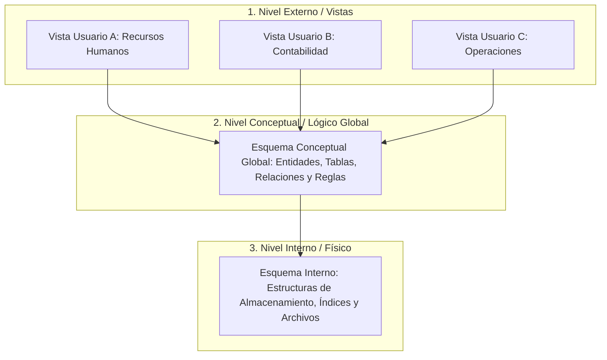

# Arquitectura de tres niveles (ANSI/SPARC)

## Código Mermaid

## Archivos del diagrama

- [`arquitectura_tres_niveles.svg`](arquitectura_tres_niveles.svg): fuente vectorial (SVG)
- [`arquitectura_tres_niveles.pdf`](arquitectura_tres_niveles.pdf): versión en PDF vectorial
- [`arquitectura_tres_niveles.mmd`](arquitectura_tres_niveles.mmd): código fuente Mermaid
