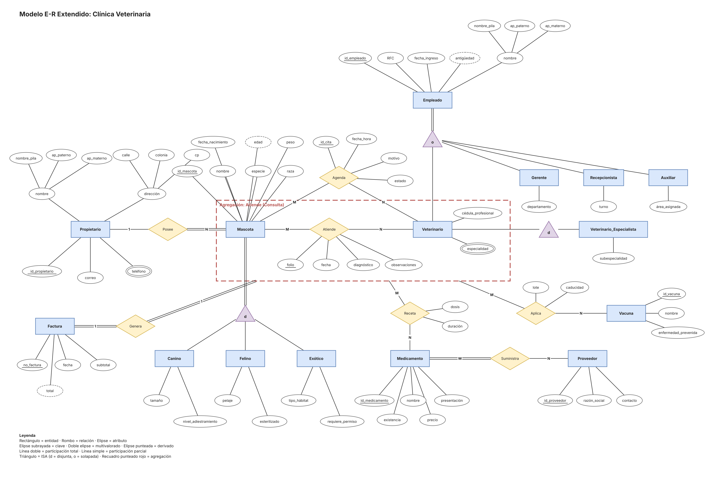

# Unidad 2 · Tarea 2.1: Modelado conceptual E-R y E-R Extendido de un caso real

**Materia:** Estructura de Datos
**Alumno:** Ximena Sánchez Lugo
**Docente:** Rubén Miguel Riojas Rodríguez
**Institución:** Instituto Tecnológico Superior de Monclova (ITSM)

## Contenido de la carpeta

| Archivo | Descripción |
|---|---|
| [`Tarea2.1_Modelado_ER_ERE.pdf`](Tarea2.1_Modelado_ER_ERE.pdf) | Reporte técnico: planteamiento, reglas de negocio, diagrama E-R/E-RE, justificación de diseño y referencias |
| [`veterinaria.drawio`](veterinaria.drawio) | Archivo fuente editable del diagrama (draw.io / diagrams.net) |
| [`diagrama_ER.png`](diagrama_ER.png) | Exportación del diagrama en imagen |
| [`diagrama_ER.pdf`](diagrama_ER.pdf) | Exportación del diagrama en PDF vectorial |
| [`reglas_negocio.md`](reglas_negocio.md) | Reglas de negocio |
| [`entidades_atributos.md`](entidades_atributos.md) | Clasificación de entidades y atributos |
| [`matriz_relaciones.md`](matriz_relaciones.md) | Matriz de relaciones, cardinalidades y participación |

## Video explicativo

[Enlace de YouTube (pendiente de agregar)](https://youtube.com/)

---

## Introducción

El diseño conceptual de una base de datos es la fase en la que los requerimientos del mundo real se traducen en estructuras de información organizadas. En este trabajo se modela el entorno operativo de una **clínica veterinaria** con el Modelo Entidad-Relación (E-R) y sus extensiones (E-RE): atributos compuestos, derivados y multivalorados, especialización y generalización, jerarquías de varios niveles y agregación. El diagrama se elaboró con la herramienta CASE **draw.io (diagrams.net)**, en notación de Chen.

## Planteamiento del problema real

Una clínica veterinaria lleva el control de propietarios, mascotas, citas, consultas, medicamentos y facturas en cuadernos y hojas de cálculo. Esto provoca historiales clínicos incompletos, citas duplicadas, errores en el inventario de medicamentos y vacunas aplicadas sin registro. Se requiere una base de datos que centralice la información clínica, administrativa y de inventario para automatizar el registro de propietarios, la atención médica de mascotas (caninos, felinos y exóticos), el control de personal, la agenda de citas, la prescripción de medicamentos, la vacunación y la facturación.

## Reglas de negocio

| # | Regla de negocio |
|---|---|
| 1 | Un propietario puede registrar varias mascotas; toda mascota pertenece a un solo propietario responsable. |
| 2 | Un propietario tiene uno o más teléfonos de contacto. |
| 3 | Toda mascota se clasifica en exactamente una categoría: canino, felino o exótico (especialización disjunta y total), cada una con atributos propios. |
| 4 | El personal se clasifica en veterinario, gerente, recepcionista o auxiliar. Una persona puede tener más de un rol, por ejemplo un veterinario que también es gerente (especialización solapada). |
| 5 | Un veterinario tiene cédula profesional y una o más especialidades; algunos se registran como veterinarios especialistas con una subespecialidad (jerarquía de tres niveles). |
| 6 | Una cita (relación Agenda) se agenda para una mascota con un veterinario, con fecha y hora, motivo y estado. Un veterinario no puede tener dos citas a la misma hora. |
| 7 | Una atención (relación Atiende) vincula a la mascota con el veterinario y registra folio, fecha, diagnóstico y observaciones. No toda cita se concreta. |
| 8 | En cada atención el veterinario puede recetar cero o más medicamentos, indicando dosis y duración (relación Receta sobre la agregación Atiende). |
| 9 | Un medicamento es suministrado por uno o varios proveedores; un proveedor puede surtir varios medicamentos. |
| 10 | Las vacunas aplicadas en una atención se registran con lote y fecha de caducidad (relación Aplica). |
| 11 | Toda atención genera exactamente una factura; el total se deriva de subtotal, servicios y medicamentos (relación Genera). |
| 12 | No se vende un medicamento caducado ni sin existencia. |

## Clasificación de entidades y atributos

Notación: **PK** = clave; **(c)** = compuesto; **{m}** = multivalorado; **/d/** = derivado.

| Entidad | Tipo | Atributos |
|---|---|---|
| **Propietario** | Fuerte | **id_propietario** (PK), nombre (c: nombre_pila, ap_paterno, ap_materno), dirección (c: calle, colonia, cp), correo, {teléfono} |
| **Mascota** | Fuerte (superentidad) | **id_mascota** (PK), nombre, especie, raza, fecha_nacimiento, /edad/, peso |
| **Canino / Felino / Exótico** | Subentidades | Canino: tamaño, nivel_adiestramiento. Felino: pelaje, esterilizado. Exótico: tipo_hábitat, requiere_permiso |
| **Empleado** | Fuerte (superentidad) | **id_empleado** (PK), nombre (c), RFC, fecha_ingreso, /antigüedad/ |
| **Veterinario** | Subentidad de Empleado | cédula_profesional, {especialidad} |
| **Gerente / Recepcionista / Auxiliar** | Subentidades de Empleado | departamento / turno / área_asignada |
| **Veterinario_Especialista** | Subentidad de Veterinario | subespecialidad |
| **Medicamento** | Fuerte | **id_medicamento** (PK), nombre, presentación, existencia, precio |
| **Proveedor** | Fuerte | **id_proveedor** (PK), razón_social, contacto |
| **Vacuna** | Fuerte | **id_vacuna** (PK), nombre, enfermedad_prevenida |
| **Factura** | Fuerte | **no_factura** (PK), fecha, subtotal, /total/ |

## Matriz de relaciones, cardinalidades y participación

| Relación | Entidades | Cardinalidad | Participación | Atributos |
|---|---|---|---|---|
| **Posee** | Propietario – Mascota | 1:N | Mascota total; Propietario parcial | — |
| **Agenda** | Mascota – Veterinario | M:N | Parcial en ambos | id_cita (PK), fecha_hora, motivo, estado |
| **Atiende** | Mascota – Veterinario | M:N | Parcial en ambos | folio (PK), fecha, diagnóstico, observaciones |
| **Receta** | Agregación (Atiende) – Medicamento | M:N | Parcial en ambos | dosis, duración |
| **Aplica** | Agregación (Atiende) – Vacuna | M:N | Parcial en ambos | lote, caducidad |
| **Genera** | Agregación (Atiende) – Factura | 1:1 | Total en ambos | — |
| **Suministra** | Medicamento – Proveedor | M:N | Medicamento total; Proveedor parcial | — |

## Conceptos del modelo E-R Extendido aplicados

- **Especialización disjunta y total (d):** Mascota se especializa en Canino, Felino o Exótico.
- **Especialización solapada (o):** Empleado se especializa en Veterinario, Gerente, Recepcionista y Auxiliar; una misma persona puede tener varios roles.
- **Jerarquía de varios niveles:** Empleado → Veterinario → Veterinario_Especialista.
- **Agregación:** la relación Atiende (Mascota–Veterinario) se trata como una entidad abstracta que participa en Receta, Aplica y Genera.

## Diagrama E-R / E-RE

## Justificación de diseño

- **Agenda y Atiende como relaciones distintas:** una cita y una atención tienen ciclos de vida diferentes; una cita puede cancelarse sin generar atención.
- **Especialización en Mascota:** cada tipo tiene atributos propios; se evitan valores nulos de una tabla genérica.
- **Especialización solapada en Empleado:** un veterinario puede ser también gerente sin duplicar a la persona.
- **Agregación en lugar de relación ternaria:** permite ligar recetas, vacunas y facturas a una atención concreta.
- **Multivalorados (teléfono, especialidad):** su cantidad varía; en el modelo lógico serán tablas aparte.
- **Derivados (edad, antigüedad, total):** se calculan, no se almacenan.
- **Compuestos (nombre, dirección):** permiten buscar y ordenar por componente.
- **Participación total en Genera y Suministra:** no existen atenciones sin factura ni medicamentos sin proveedor.

## Conclusión

El modelo E-R Extendido permitió representar con precisión las reglas de la clínica veterinaria, incluyendo especializaciones disjuntas y solapadas, jerarquías y la agregación de una relación para vincularla con recetas, vacunas y facturas. El diagrama es la base para el modelo lógico relacional, donde las especializaciones, los atributos multivalorados y las relaciones M:N se convertirán en tablas con sus claves foráneas.

## Referencias bibliográficas (APA)

- Chen, P. P. (1976). The entity-relationship model: Toward a unified view of data. *ACM Transactions on Database Systems, 1*(1), 9-36.
- Coronel, C., & Morris, S. (2019). *Database systems: Design, implementation, & management* (13th ed.). Cengage Learning.
- Date, C. J. (2003). *An introduction to database systems* (8th ed.). Addison-Wesley.
- Elmasri, R., & Navathe, S. B. (2015). *Fundamentals of database systems* (7th ed.). Pearson.
- Silberschatz, A., Korth, H. F., & Sudarshan, S. (2020). *Database system concepts* (7th ed.). McGraw-Hill Education.
