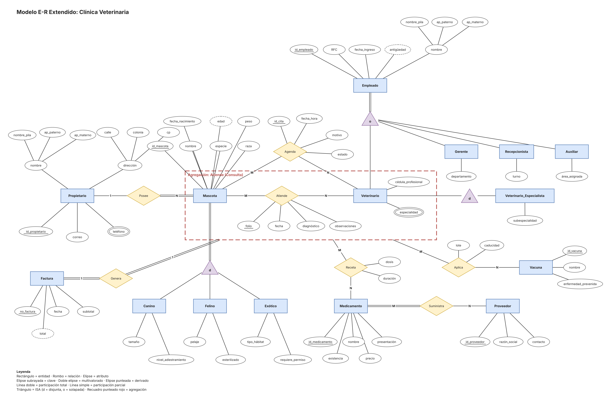
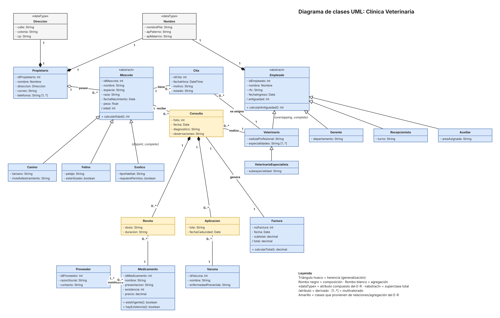

# Unidad 2 · Tarea 2.2: Transición de diagrama E-R a notación UML

**Materia:** Estructura de Datos
**Alumno:** Ximena Sánchez Lugo
**Docente:** Rubén Miguel Riojas Rodríguez
**Institución:** Instituto Tecnológico Superior de Monclova (ITSM)

## Contenido de la carpeta

| Archivo | Descripción |
|---|---|
| [`Tarea2.2_ER_vs_UML.pdf`](Tarea2.2_ER_vs_UML.pdf) | Documento con la comparativa detallada E-R vs. UML y el análisis de coincidencias |
| [`veterinaria_uml.drawio`](veterinaria_uml.drawio) | Diagrama de clases UML en formato editable (draw.io / diagrams.net) |
| [`diagrama_UML.png`](diagrama_UML.png) | Exportación del diagrama de clases en imagen |
| [`diagrama_UML.pdf`](diagrama_UML.pdf) | Exportación del diagrama de clases en PDF vectorial |
| [`diagrama_ER_origen.png`](diagrama_ER_origen.png) | Diagrama E-R de origen (Tarea 2.1) |
| [`tabla_comparativa_er_uml.md`](tabla_comparativa_er_uml.md) | Tabla comparativa de correspondencia directa |
| [`correspondencia_entidad_clase.md`](correspondencia_entidad_clase.md) | Correspondencia entidad → clase |
| [`mapeo_orm.md`](mapeo_orm.md) | Implicaciones para el desarrollo orientado a objetos |

## Video explicativo

[Enlace de YouTube (pendiente de agregar)](https://youtube.com/)

---

## Introducción

El modelo Entidad-Relación Extendido (E-RE) es la base del diseño de la base de datos relacional; sin embargo, en el desarrollo orientado a objetos (POO) la estructura del sistema se representa con **diagramas de clases UML**. Este reporte parte del diagrama E-RE de la clínica veterinaria (Tarea 2.1) y lo convierte a un diagrama de clases, estableciendo la correspondencia entre entidades y clases, atributos y propiedades, y relaciones y asociaciones (composición, agregación y herencia).

## Diagrama E-R de origen

## Diagrama de clases UML

## Tabla comparativa de correspondencia directa

### a) Elementos estructurales

| Elemento E-R Extendido | Notación UML (clases) | Aplicación en la clínica veterinaria |
|---|---|---|
| Entidad (rectángulo) | Clase | Propietario, Medicamento, Proveedor, Vacuna, Factura |
| Superentidad con especialización total | Clase abstracta («abstract», nombre en cursiva) | Mascota y Empleado |
| Atributo simple | Atributo con visibilidad y tipo | `- peso: float`, `- correo: String` |
| Atributo clave (subrayado) | Atributo identificador (UML no tiene símbolo de PK) | `- idPropietario: int`, `- idMascota: int` |
| Atributo compuesto | Clase «dataType» unida por composición | Nombre (nombrePila, apPaterno, apMaterno) y Direccion (calle, colonia, cp) |
| Atributo multivalorado (doble elipse) | Atributo con multiplicidad [1..*] | `telefonos: String [1..*]`; `especialidades: String [1..*]` |
| Atributo derivado (elipse punteada) | Atributo con prefijo `/` y método de cálculo | `/ edad` con `calcularEdad()`; `/ antiguedad`; `/ total` con `calcularTotal()` |
| Relación M:N con atributos | Clase de asociación o clase intermedia (reificación) | Agenda → Cita; Atiende → Consulta; Receta; Aplica → Aplicacion |

### b) Relaciones, restricciones y jerarquías

| Elemento E-R Extendido | Notación UML (clases) | Aplicación en la clínica veterinaria |
|---|---|---|
| Relación 1:N (Posee) | Agregación con multiplicidad 1 y 0..* | Propietario 1 ◇— 0..* Mascota (rombo blanco) |
| Relación 1:1 (Genera) | Asociación con multiplicidad 1 a 1 | Consulta 1 — 1 Factura |
| Relación M:N (Suministra) | Asociación 0..* a 1..* | Medicamento 0..* — 1..* Proveedor |
| Participación total | Multiplicidad mínima 1 (o 1..*) | Mascota siempre tiene propietario; Medicamento 1..* Proveedor |
| Participación parcial | Multiplicidad mínima 0 | Propietario 0..* Mascota; Consulta 0..* Receta |
| Especialización disjunta y total (d) | Herencia con {disjoint, complete} | Canino, Felino y Exotico heredan de Mascota |
| Especialización solapada (o) | Herencia con {overlapping, complete} | Veterinario, Gerente, Recepcionista y Auxiliar heredan de Empleado |
| Jerarquía de varios niveles | Cadena de herencia | Empleado → Veterinario → VeterinarioEspecialista |
| Agregación E-R (relación como entidad abstracta) | Clase propia con composición hacia sus partes (rombo negro) | Consulta ◆ Receta; Consulta ◆ Aplicacion; Consulta — Factura |
| Atributo compuesto (parte del todo) | Composición (rombo negro) | Propietario ◆ Direccion; Propietario ◆ Nombre; Empleado ◆ Nombre |

## Correspondencia entidad → clase

| Objeto en el E-RE | Clase UML | Observación |
|---|---|---|
| Propietario | Propietario | Contiene Nombre y Direccion por composición |
| Mascota | «abstract» Mascota | Superclase; hereda a Canino, Felino, Exotico |
| Canino, Felino, Exótico | Canino, Felino, Exotico | Atributos propios de cada tipo |
| Empleado | «abstract» Empleado | Superclase con jerarquía solapada |
| Veterinario, Gerente, Recepcionista, Auxiliar | Veterinario, Gerente, Recepcionista, Auxiliar | Un empleado puede tener varios roles |
| Veterinario_Especialista | VeterinarioEspecialista | Hereda de Veterinario (nivel 3) |
| Relación Agenda | Clase Cita | Asociada 0..* con Mascota y con Veterinario |
| Relación Atiende (agregación) | Clase Consulta | Dueña de Receta y Aplicacion (composición); genera Factura |
| Relación Receta | Clase Receta | Atributos dosis y duracion; apunta a un Medicamento |
| Relación Aplica | Clase Aplicacion | Atributos lote y fechaCaducidad; apunta a una Vacuna |
| Medicamento, Proveedor, Vacuna, Factura | Medicamento, Proveedor, Vacuna, Factura | Con métodos estaVigente(), hayExistencia(), calcularTotal() |
| Atributos compuestos nombre y dirección | «dataType» Nombre y Direccion | Tipos de valor reutilizables |

## Análisis de coincidencias y diferencias lógicas

### Coincidencias

- **Estructura equivalente:** las entidades, sus atributos y sus relaciones se corresponden uno a uno con clases, propiedades y asociaciones.
- **Restricciones preservadas:** las cardinalidades del E-R se vuelven multiplicidades y la participación total o parcial se conserva en la multiplicidad mínima.
- **Generalización/especialización:** equivalen a la herencia; las restricciones d/o pasan a {disjoint}/{overlapping}.
- **Atributos especiales:** los compuestos, multivalorados y derivados tienen representación en ambas notaciones.

### Diferencias

- **Comportamiento:** el E-R solo describe datos; UML añade operaciones como `+ calcularTotal()` en Factura y `+ hayExistencia()` en Medicamento.
- **Visibilidad y tipos:** UML indica la visibilidad y el tipo de cada atributo; el E-R no.
- **Claves:** el E-R subraya la clave primaria; UML no tiene ese concepto. Los id se conservan como atributos para la persistencia.
- **Relaciones M:N con atributos:** en UML se resuelven como clase de asociación o clase intermedia.
- **Agregación:** en E-R convierte una relación en entidad abstracta; en UML es una relación parte-todo débil. Por eso Atiende se materializa como la clase *Consulta* con composición hacia Receta y Aplicacion.
- **Rol solapado:** la herencia de UML asigna una sola clase a cada objeto; el veterinario que también es gerente se resuelve en código con roles, no con herencia múltiple.

## Implicaciones para el desarrollo orientado a objetos

| Construcción UML | Implementación en código | Implementación en la base de datos |
|---|---|---|
| Clase | Clase de dominio / entidad del ORM | Tabla |
| Herencia (Mascota → Canino…) | `extends` / herencia de clases | Tabla por jerarquía, o tabla por subclase con clave compartida |
| Composición con «dataType» | Objeto incrustado (`@Embedded`) | Columnas dentro de la tabla del propietario |
| Atributo multivalorado [1..*] | Colección (`List<String>`) | Tabla aparte con clave foránea |
| Atributo derivado `/` | Método o propiedad calculada, no persistente | No se almacena |
| Asociación 1 — 0..* | Referencia y colección | Clave foránea en el lado «muchos» |
| Asociación 0..* — 1..* (Suministra) | Colecciones en ambos lados | Tabla intermedia con dos claves foráneas |
| Composición Consulta ◆ Receta | Colección propia de la consulta (cascade) | Clave foránea; se elimina junto con la consulta |

## Conclusión

La transición del E-RE a UML muestra que ambos modelos son complementarios: el E-RE garantiza una estructura de datos íntegra y UML añade comportamiento, encapsulamiento y herencia. La correspondencia entre entidades y clases, relaciones y asociaciones, y especialización y herencia permite mantener un solo diseño coherente de la base de datos y del código, y facilita el uso de ORMs. Las diferencias señaladas (claves, agregación, roles solapados) deben atenderse al implementar.

## Referencias bibliográficas (APA)

- Ambler, S. W. (2004). *The elements of UML 2.0 style*. Cambridge University Press.
- Elmasri, R., & Navathe, S. B. (2015). *Fundamentals of database systems* (7th ed.). Pearson.
- Fowler, M. (2004). *UML distilled: A brief guide to the standard object modeling language* (3rd ed.). Addison-Wesley.
